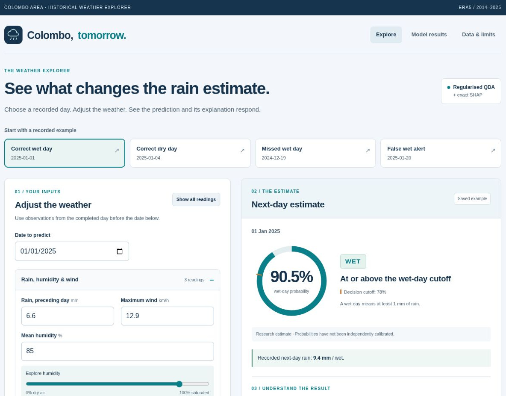
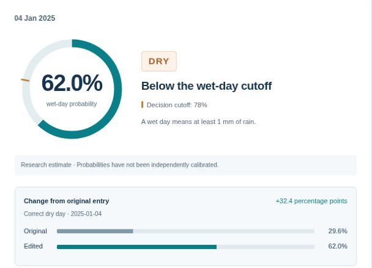
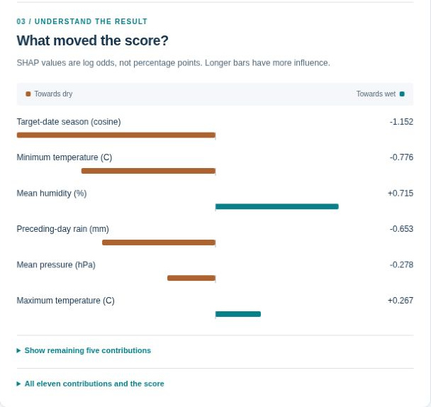
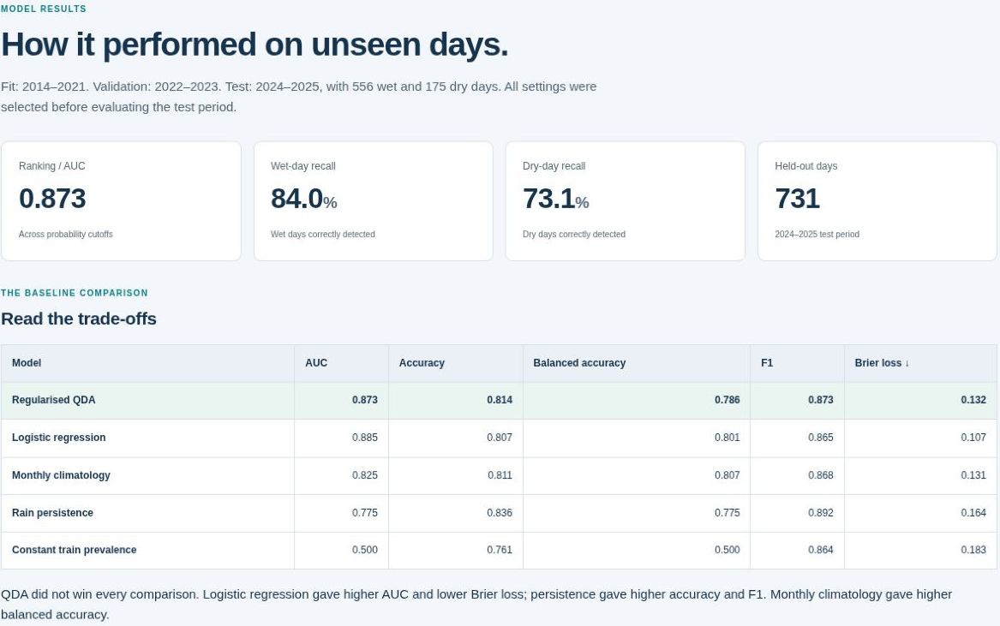

# Project links

**IT5514 - Applied Machine Learning**  
Pansilu Ashinshana Wijesiri | 269220E

- [Live application on Azure](https://colombo-rain-269220e-h4exayebdwandnc2.centralindia-01.azurewebsites.net/)
- [GitHub repository](https://github.com/PansiluAW/colombo-rain-study-ML)
- [Assignment report](report/269220E_ML_Report.pdf)
- [Dataset and source details](data/)
- [Evaluation results and training figures](results/)

The Azure explorer provides grouped weather controls, a probability dial, original/edited comparisons and SHAP explanations. The report includes Azure, GitHub, dataset and source screenshots. This is a historical research demonstration.

## Application screenshots

